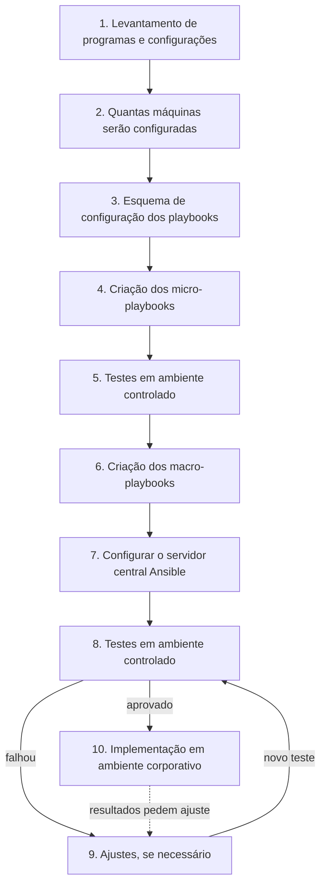

# Projeto Ansible: do levantamento à implantação

Este repositório documenta o processo que segui para automatizar a configuração das máquinas com Ansible, em dez etapas: do levantamento das necessidades até a implantação gradual em ambiente corporativo.

Há também uma versão interativa deste mapa neste repositório através do arquivo "mapa-ansible.html".

## Visão geral do processo

## As etapas

### 1. Levantamento de programas e configurações

Antes de escrever qualquer playbook, é preciso saber o que cada espaço realmente precisa: quais programas instalar e quais configurações aplicar. Esse levantamento parte de quem usa as máquinas no dia a dia.

- **Entrevistar docentes e discentes** sobre possíveis novos softwares e necessidades, assim como inconvenientes e dificuldades com ferramentas e softwares já instalados.
- **Criar um arquivo de requisições** com todas as requisições e instalações pertinentes e as configurações possíveis para os espaços destinados. Registrar e seguir o processo.

### 2. Quantas máquinas serão configuradas

Com as necessidades em mãos, o passo seguinte é saber onde elas serão aplicadas: quantas máquinas existem e como se organizam.

- **Grupos e zonas de IP:** levantar as máquinas a serem configuradas, separar em grupos e registrar os IPs por “zonas” associadas aos grupos, que serão utilizadas pelos macro-playbooks. Registrar e seguir o processo.

> **Conceito: inventário.** No Ansible, essa lista de máquinas e grupos vira o inventário, o arquivo que diz ao servidor quais hosts existem e a que grupo cada um pertence.

### 3. Esquema de configuração dos playbooks

Aqui se define a arquitetura da solução: de onde os playbooks partem e como chegam às máquinas.

- **Servidor central orquestrador:** um servidor central dispara os playbooks para os grupos de IP designados. Ele guarda todos os arquivos de configuração, os playbooks e a chave SSH única de acesso aos computadores-alvo.

> **Conceito: sem agente.** O Ansible não exige nenhum programa instalado nas máquinas-alvo. O servidor se conecta a elas por SSH e executa as tarefas remotamente, por isso a chave SSH é peça central do esquema.

### 4. Criação dos micro-playbooks

Os micro-playbooks são as peças pequenas do projeto. Cada um cuida de um conjunto de tarefas, e depois eles são combinados conforme a necessidade de cada grupo.

- **Tasks de instalação e configuração:** pacotes de base, snaps, sistema de avisos, scripts de manutenção, configuração do ambiente de programação, instalação de softwares e drivers diversos.
- **Boas práticas:** preservar idempotência e YAML limpo nos playbooks.

> **Conceito: idempotência.** Um playbook idempotente pode ser executado várias vezes e sempre leva a máquina ao mesmo estado final, sem repetir alterações que já foram feitas.

### 5. Testes em ambiente controlado

Primeira rodada de testes: os micro-playbooks são executados em um ambiente isolado antes de chegarem perto das máquinas reais.

- **VM com a mesma ISO dos hosts:** criar uma máquina virtual no VMware com a mesma ISO que será usada nos hosts finais e rodar os playbooks nela para fins de teste.

### 6. Criação dos macro-playbooks

Com os micro-playbooks validados, eles são reunidos em macro-playbooks: um conjunto para cada grupo de máquinas levantado na etapa 2.

- **Playbooks por grupo e zonas de IP:** criar os macro-playbooks conforme as necessidades dos grupos, assim como as zonas de IP de cada grupo.

### 7. Configurar o servidor central Ansible

O servidor que vai orquestrar tudo é montado e recebe os arquivos produzidos nas etapas anteriores.

- **Instalar o Ansible e migrar os arquivos:** inventário de IPs, instalação da chave SSH nos hosts finais, micro e macro-playbooks, arquivo para armazenamento de logs e `ansible.cfg`.

### 8. Testes em ambiente controlado

Segunda rodada de testes, agora com o servidor central já configurado, novamente em uma VM com a mesma ISO dos hosts finais. Se algo falhar, o processo vai para os ajustes e volta a esta etapa. Se a rodada for aprovada, segue para a implementação.

### 9. Ajustes, se necessário

Corrigir o que os testes ou a implantação revelarem e testar de novo. O ciclo se repete até a rodada passar sem problemas.

### 10. Implementação em ambiente corporativo

A ferramenta entra em uso nas máquinas reais.

- **Implantação gradual:** implementar aos poucos, com um período de análise de resultados. O que aparecer durante a implantação volta para a etapa de ajustes.
